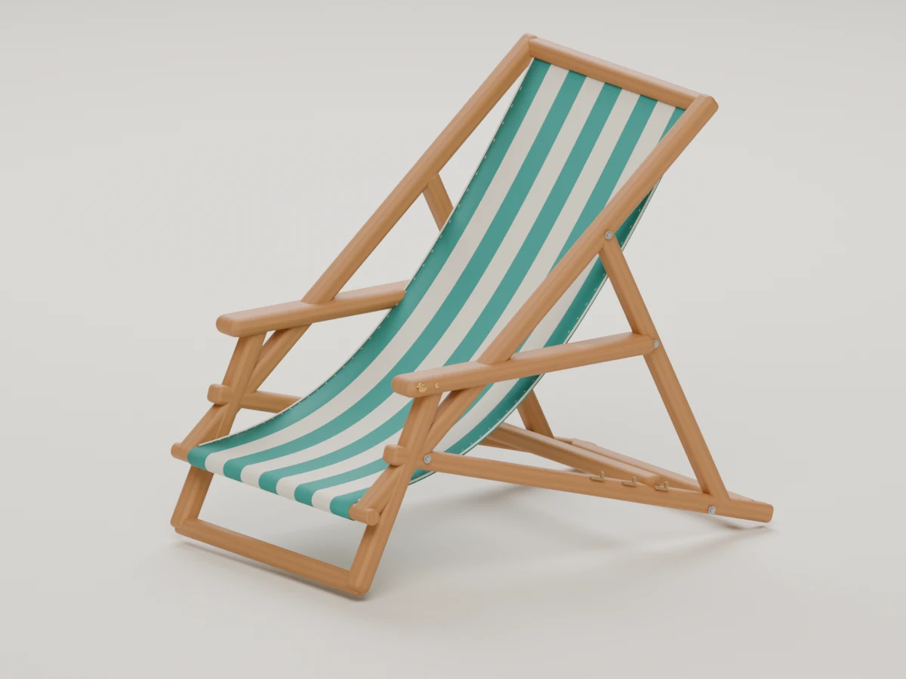
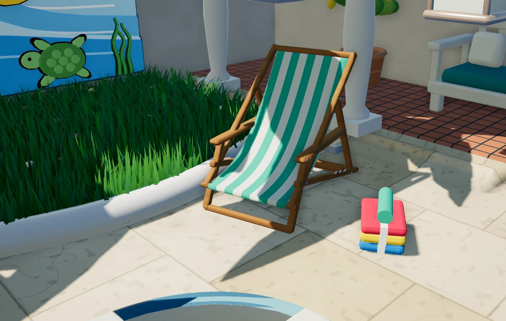

# Rubber Duck Pool 에셋 아트 디렉션

> 기준점: 2026-11-01 데크 체어 v5. 이 문서는 앞으로 만드는 환경·소품의 **방향**을 기록한다. 의자의 모든 색과 디테일을 모든 에셋에 반복하라는 규칙은 아니다. 러버덕의 기존 디자인은 별도로 유지한다.

## 우리가 만들고 싶은 분위기

햇볕이 따뜻하게 드는 작은 바닷가 리조트. 깨끗하고 정돈되어 있지만 차갑거나 고급 호텔처럼 격식 있지는 않다. 편하게 앉아 물과 바다를 바라보고 싶은 곳이다. 친근한 러버덕이 중심이며, 주변 사물은 귀엽게 데포르메하되 실제로 사람이 사용할 수 있을 것 같은 설득력을 가진다.

**따뜻한 원목, 맑은 청록, 부드러운 아이보리, 둥글게 마감된 형태, 작은 손길이 느껴지는 디테일.** 색과 형태가 먼저 읽히고, 가까이서 보면 재질과 결합 방식이 보이는 에셋을 지향한다.

## 기준 이미지

| 스튜디오에서 보는 목표 | 게임에 들어간 현재 결과 |
| --- | --- |
|  |  |

[앞 봉과 천의 접사](evidence/chair-design-detail.webp). 스튜디오 이미지는 Blender의 재질·조명 아래에서 본 **목표 이미지**이고, 게임 이미지는 2026-11-01 실제 브라우저 게임에서 확인한 **현재 구현**이다. 서로 다른 렌더러이므로 재질과 조명이 같다고 간주하지 않는다.

## 조형과 재질

- **실루엣:** 멀리서도 용도가 읽혀야 한다. 과장된 비율보다 둥근 모서리와 부드러운 곡선으로 친근함을 만든다. 너무 뾰족하거나 장난감 블록처럼 각진 형태는 피한다.
- **구조:** 프레임, 봉, 천, 결합부가 서로 어떻게 지탱되는지 납득할 수 있어야 한다. 의자의 천은 한 장이 앞 봉을 감싸며 등받이와 좌판으로 이어진다. 실제 움직임을 구현하지 않은 정적 형태와 작동하는 구조를 구분한다.
- **목재:** 노란 플라스틱이 아닌 따뜻한 벌꿀빛 원목. 결은 길이 방향으로 흐르되 반복 줄무늬처럼 보이지 않게 절제한다. 모서리는 손이 닿아도 편해 보이도록 둥글린다.
- **천:** 선명한 청록과 약간 따뜻한 흰색. 가늘고 얇은 깃발보다 탄탄한 캔버스가 자연스럽게 처지는 인상이다. 띠, 재봉선, 테두리는 천의 곡면을 따라 이어져야 한다.
- **금속과 포인트:** 와셔와 볼트는 작은 보조 요소다. 금빛 오리 장식은 가까이서 발견하는 즐거움으로 사용하며 멀리서 읽히지 않는 한계를 인정한다. 다른 에셋마다 오리 장식을 붙일 필요는 없다.
- **표면:** 과하게 광택 나는 플라스틱, 강한 오염과 스크래치보다 사용감이 거의 없는 매트한 재질과 부드러운 하이라이트를 우선한다. 표면 질감은 형태를 가리지 않는 수준으로 더한다.

## 색과 조명

대표 조합은 **원목의 따뜻한 갈색 + 청록 + 아이보리**다. 게임에서 앉을 수 있는 두 의자의 청록 배치 색상은 `#3ab89a`; 세 번째 장식용 의자는 기존 산호색을 쓴다. 화면에 보이는 색은 소재, 조명, 그림자와 후처리에 따라 달라지므로 이 값이 완성 렌더의 정확한 픽셀 색이라는 뜻은 아니다.

다른 에셋은 바다·수영장과 이어지는 청록, 해가 든 원목과 모래, 아이보리, 작은 산호색·노란색 포인트를 상황에 맞게 조합한다. 모두 같은 청록 줄무늬로 만들지 않는다. 러버덕과 물이 장면의 중심을 유지하도록 대형 장식물의 채도와 대비를 조절한다.

스튜디오에서는 넓은 부드러운 빛으로 재질과 구조를 확인한다. 게임에서는 정오의 강한 빛, 그늘, 시간대 변화 속에서도 색과 실루엣을 확인한다. 예쁜 단독 렌더 한 장만으로 게임 적용을 판정하지 않는다.

## 제작과 검토 순서

1. **게임 내 역할과 크기:** 플레이어가 어느 거리와 각도에서 보는지, 주변 사물과 어떤 관계인지 먼저 확인한다.
2. **실루엣과 구조:** 실제 사용을 상상할 수 있는 비율과 접합부를 만든다. 정면·측면·뒷면 및 필요한 접사로 확인한다.
3. **재질과 색:** 목재·천·금속을 구분하고, 원본 렌더에서 표면과 마감을 확인한다.
4. **게임 적용:** 실제 카메라, 조명, 배치 및 접지를 확인한다. 상호작용이 있는 에셋은 클릭과 기능도 확인한다.
5. **비용과 검증:** 게임용 모델의 삼각형 수와 파일 크기를 기록하고, 원본 대비 손실 및 실제 기기 성능 확인 여부를 구분한다. 숫자만으로 충분한 성능을 보장하지 않는다.
6. **피드백:** 독립 평가와 변경 전후 이미지를 비교하고, 개선이 보이지 않거나 회귀한 부분은 솔직하게 남긴다.

## 현재 의자의 기준과 한계

- 원본 제작: `tools/create_resort_chair_v5.py` → 로컬 `models/deck-chair-atelier-v5.blend`, GLB 및 스튜디오 렌더. `models/`는 Git에서 제외된다.
- 게임용 변환: Blender에서 위 `.blend`를 연 상태로 `tools/export_resort_chair.py`를 실행한다. 결과는 추적되는 `public/props/resort-chair.bin`과 `src/pool/chair-shapes.js`다. 게임은 `src/pool/props.js`에서 이 모델을 사용한다.
- 게임용 모델: **15,492 triangles / 17,440 vertices**, 의자당. Blender 원본은 약 51,980 triangles. 현재 파일은 약 863 KiB다. 이 수치는 이번 의자의 실측치이며 모든 에셋에 적용할 예산은 아니다.
- 게임의 자체 WebGPU 렌더러는 이 변환에서 Blender의 목재·직조 이미지 텍스처를 그대로 사용하지 않는다. 게임 화면은 원본보다 재질이 단순하다.
- 팔걸이 아래 프레임이 겹쳐 보이고, 금색 오리와 앞 봉의 감김은 게임 거리에서 작다. 측면·접사 및 뒷발이 잘 보이는 각도에서 계속 검토한다. 실제 기기 성능, 모든 시간대, 모바일은 아직 별도 검증이 필요하다.
- 2026-11-01 확인: 게임 내 풀장 의자 클릭 → 앉기 메뉴 → Stand up, 전체 테스트 119/119, 프로덕션 빌드. 이는 당시 결과이며 향후 변경 뒤 재검증해야 한다.

## 룩데브 소품과 수집품의 게임 모델 (2026-11-05)

- 원본: `assets/02_models/props/`의 파라솔(v7), 타월(r33), 모래 양동이(v13), 구명환(v4-game), 서프보드(v7), 비치볼(v6), `tools/create_beach_props.py`가 만드는 모래성·조개·불가사리·유목(`sandcastle/` 등), 그리고 `tools/create_collectibles.py`가 만드는 수집품 열둘(`collectibles/`, 선반 둘).
- 게임용 변환: `npm run assets:lookdev`(`tools/export_lookdev_props.py`). 결과는 추적되는 `public/props/lookdev.bin`(약 4.9 MB)과 `src/pool/lookdev-shapes.js`이고, `src/pool/props.js`가 같은 이름의 모델을 이것으로 바꾼다. 각 모델의 재질별 표면 종류와 색은 실행 로그의 `LOOKDEV_MATERIAL` 줄로 확인한다.
- 게임용 모델(삼각형, 원본 → 게임): 파라솔 37,292 → 6,984(바느질선 제외), 타월 489,986 → 4,998, 양동이 103,840 → 4,993(흩어진 모래알 제외), 구명환 39,712 → 4,457, 서프보드 34,324 → 7,053(아래 무늬 나누기 포함), 비치볼 36,024 → 4,490. 해변 소품은 줄이지 않음: 모래성 3,532, 조개 536, 불가사리 850, 유목 748(모래성과 유목은 `colours`로 해변에 맞춘 색, 조개는 무광). 수집품은 줄이지 않음: 범선 병 7,386, 증기선 병 3,887, 해적선 병 2,789, 화산 2,860, 정글 2,672, 눈 덮인 섬 1,236. 두 번째 선반: 노 젓는 배 병 3,099, 잠수함 병 3,659, 롱십 병 3,864, 등대 섬 1,768, 난파선 암초 2,604, 어촌 2,346(룩데브 모델 모두 76,811 삼각형). 등대와 랜턴의 불빛은 `Lamp` 재질(빛나는 유리, 종류 9). 수집품은 바다와 풀에 하나씩 두 번 그려진다.
- 이 변환은 삼각형마다 한 가지 색을 쓴다. 이미지로 칠한 재질은 줄인 뒤 삼각형을 넷으로 세 번까지 나눠, 꼭짓점·변 가운데·중심에서 읽은 색이 0.08보다 다를 때만 나누고 각 조각에 중심 색을 준다(`cut()`). 그래서 서프보드의 줄무늬는 선명하지만 경계가 조금 들쭉날쭉하다. 천의 직조와 바느질, 타월의 고리 같은 잔 디테일은 예산에서 빠진다.
- 2026-11-05 확인: 게임 안 스크린샷(모래성 옆 양동이, 파라솔, 타월, 구명환, 서프보드, 풀에 소환한 여섯, 바다에 뜬 병과 섬), 전체 테스트 138/138, 프로덕션 빌드. 실제 기기 성능, 모든 시간대, 모바일은 아직 별도 검증이 필요하다.
- 2026-11-05 해변 소품: 게임 안 스크린샷(모래성, 유목, 불가사리, 조개)과 Blender 렌더 `production/qa/evidence/beach-props-2026-11-05/`, 전체 테스트 140/140.
