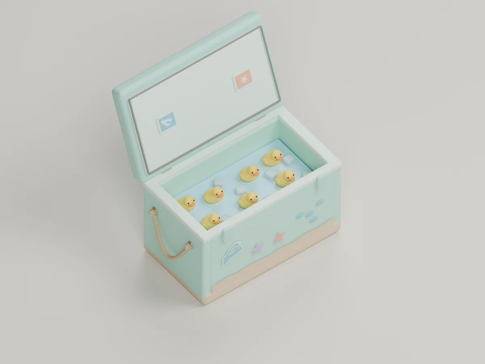
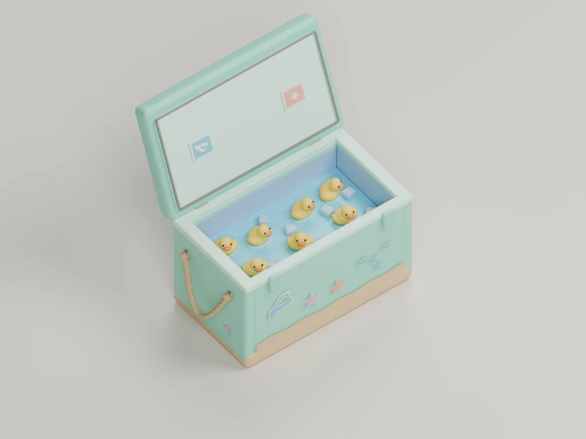
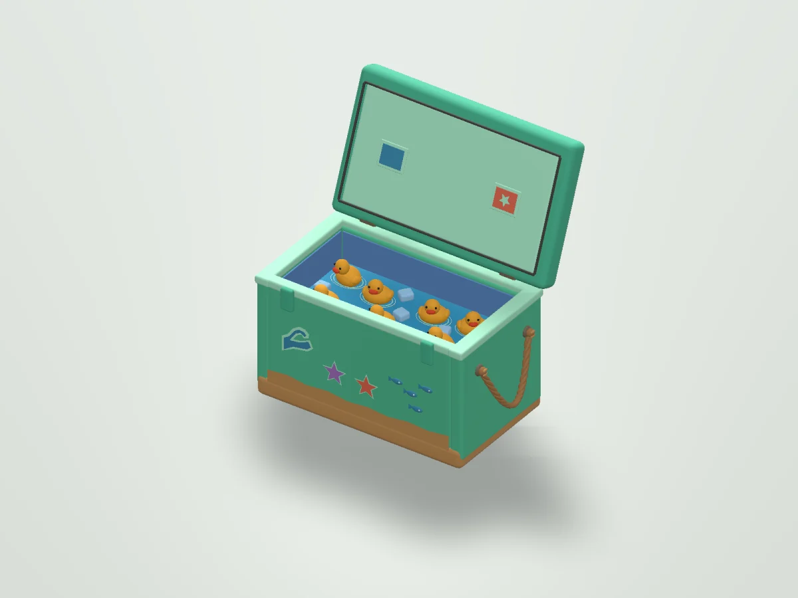
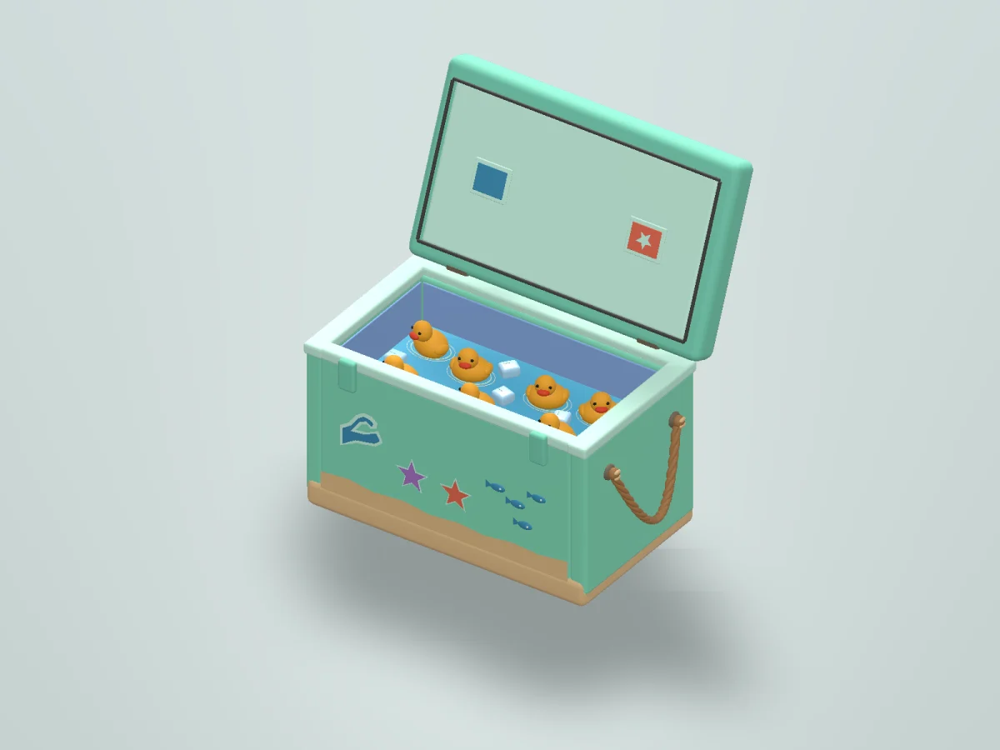
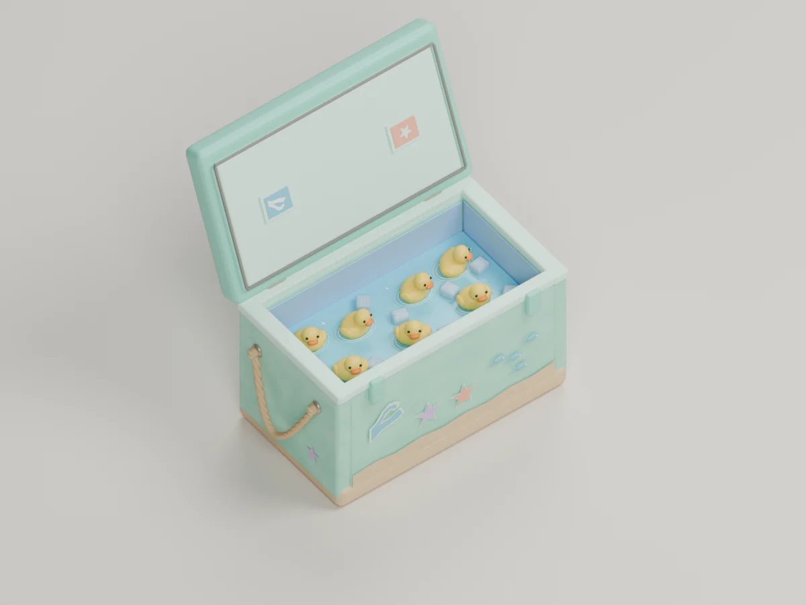
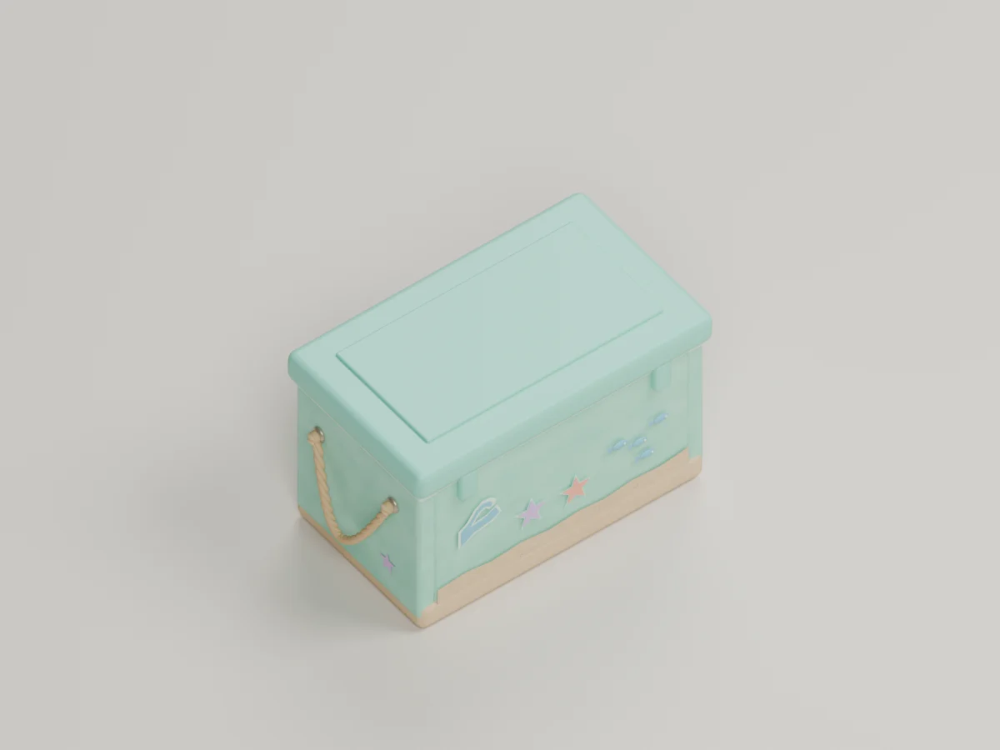

# 아이스박스 룩 개발

상태: 독립 제작 중. 게임에 배치하거나 입력을 연결하지 않았다.

## 의도

사용자가 제공한 민트색 아이스박스 이미지를 기준으로 한다. 모래색 아랫부분, 밧줄 손잡이, 파도·불가사리 장식, 파란 물과 얼음 사이의 작은 오리가 특징이다. 내부 오리는 장식이며 수영장 시뮬레이션 오리와는 별도다. 뚜껑은 `Lid hinge`에 묶여 있어 이후 클릭 동작을 연결할 수 있다.

## 제작 기록

- Blender에서 몸체, 내부, 일곱 마리 오리, 얼음, 손잡이와 힌지를 구성했다.
- Unity에 FBX를 가져와 확인하면서 방향, 재질 전달, 빠진 로프, 장식의 앞면 방향을 수정했다. Blender에서 열림과 닫힘을 별도로 확인한다.
- `tools/create_resort_cooler.py`는 로컬 `models/resort-cooler-reference-v4.blend`, 열린 상태 FBX와 열림·닫힘 Blender 렌더를 생성한다. `models/`는 Git 추적 대상이 아니다.
- `tools/render_resort_cooler_unity.cs`는 별도 Unity 프로젝트의 `Assets/Editor/`에 넣어 실행하는 검수 도구다. FBX는 `Assets/Cooler.fbx`로 복사한다. Unity Built-in 렌더러와 임시 재질 색을 사용한다. 저장 경로는 `COOLER_RENDER_PATH`로 지정할 수 있다.

## 남은 작업

참고 이미지 수준의 밧줄 매듭, 물과 얼음 재질, 스티커 세부 표현을 더 다듬고, 카메라 거리별 가독성과 최적화를 확인해야 한다. 열린 상태의 FBX는 검수용이며 게임용 통합과 클릭 애니메이션 검증은 별도 단계다.

## Blender 디테일 v2 — 2026-11-01

기존 원본은 보존하고 새 버전을 만들었다. 로프 끝 매듭, 뚜껑의 밀폐 테두리, 얼음 하이라이트, 뚜껑 안쪽의 파도와 별을 추가했다. 몸체·모래·밧줄·물에 미세한 표면 요철을 주고 얼음에 빛 투과를 적용했다. Cycles 128 샘플과 1800×1350 렌더로 열린 상태와 닫힌 상태를 확인했다.

처음에는 힌지 상단이 화면 밖으로 잘려 카메라를 다시 조정했다. Blender 원본 재열기 검사에서 장식 오리 7마리, 힌지의 자식, 로프 매듭·뚜껑 밀폐부·얼음 하이라이트가 있는 것을 확인했다. 이 버전의 Unity 및 실제 게임 렌더는 별도로 확인하지 않았다. 물은 정적인 평면이고 얼음의 표현과 전체 모양은 참고 이미지보다 단순하므로 여전히 개선 여지가 있다.

## 참고 이미지 방향 v3 — 2026-11-01

참고 이미지의 민트색 몸체와 모래색 바닥, 파란 안감과 얼음물, 굵은 로프, 물결과 물고기·불가사리 장식을 더 강조했다. 일곱 오리의 방향을 조금씩 다르게 배치했다. 첫 렌더에서 앞 벽이 내부를 가리는 것을 확인하고 카메라를 높여 다시 렌더했다. Blender에서 원본을 다시 열어 내부 장식, 힌지와 일곱 오리의 서로 다른 방향을 확인했다.

오리 방향을 바꾸는 과정에서 마지막 날개의 크기가 비정상적으로 커져 카메라를 가리는 오류를 발견했다. 변환 갱신 시점을 수정하고 `tools/validate_resort_cooler.py`에서 모든 오리 부품의 크기를 재검사했다.

이 결과는 참고 이미지를 입체로 해석한 작업이며, 일러스트의 투명한 얼음과 물 표면의 유기적인 굴절·반짝임은 여전히 단순화되어 있다.

## v3 Unity 검수 — 2026-11-01

열린 FBX를 독립 프로젝트의 Unity 6000.6.0f1에서 1600×1200으로 렌더했다. Built-in 렌더러에 이름별 임시 단색 재질을 적용한 검수 이미지로, Blender의 재질이나 게임에서의 최종 표현을 재현한 결과는 아니다. 에디터는 종료 코드 0으로 완료했고 로그에 `COOLER_RENDER_COMPLETE`가 기록됐다.

민트색 몸체, 장식, 로프와 내부 오리는 보이지만, 원본 일러스트보다 재질이 평면적이고 얼음과 물의 투명감이 부족하다. 게임 내 배치와 클릭 동작은 아직 검증하지 않았다.

## Unity 재질과 조명 조정 — 2026-11-01

검수 장면의 민트와 모래 색을 밝히고 물의 광택과 얼음의 투명도를 조정했다. 첫 렌더에서 하이라이트가 지나치게 밝아져 조명과 배경을 줄인 후 다시 렌더했다. Unity 에디터가 종료 코드 0으로 완료했고 `COOLER_RENDER_COMPLETE`를 확인했다.

이 변경은 Built-in 렌더러의 임시 재질과 조명에만 적용된다. 여전히 몸체가 평면적이고 얼음의 굴절 및 뚜껑 파도 스티커가 충분히 표현되지 않으므로 원본에 가까워지려면 메시와 재질을 추가로 손봐야 한다.

## Blender v4 표면과 장식 — 2026-11-01

민트 몸체와 모래에 Blender 노드로 색 변화를 추가하고, 해변선에 85개의 작은 모래 알갱이와 얼음마다 반짝임을 넣었다. 뚜껑의 파도 장식을 새로 만들었고 첫 렌더에서 기존 장식과 겹친 면이 깨져 보여 기존 면을 제거한 뒤 다시 렌더했다. 1800×1350 Cycles 열림·닫힘 렌더와 Blender 파일 재열기 검사를 완료했다. 일곱 오리, 크기, 힌지, 장식 및 새 디테일을 확인했다.

표면의 노드 색 변화는 Blender 렌더 기준이며 FBX에서 같은 모습으로 전달된다고 보장하지 않는다. 이 버전의 Unity 렌더, 게임 배치와 클릭 동작은 검증하지 않았다. 얼음과 물은 참고 일러스트보다 여전히 단순하며, 모래 알갱이는 별도 메시여서 게임 적용 전 최적화가 필요하다.

## 웹 적용 — 2026-11-02

v4를 자체 렌더러의 메시 형식으로 변환해 풀장 의자 옆 두 곳과 해변 한 곳에 배치했다. 뚜껑을 별도 메시로 분리하고 각 아이스박스의 클릭 상태를 연결했다. 해변의 새 메시가 의자와 겹치지 않고 지형에 닿도록 위치를 조정했다. 변환은 `tools/export_resort_cooler.py`를 v4 Blender 파일에서 실행한다.

웹 메시 파일은 약 2.3 MiB, 44,052 vertices / 57,202 triangles이며 배치마다 복제된다. Blender 노드 질감과 굴절은 웹에 전달되지 않는다. 브라우저에서 의자 옆 닫힌 모델은 확인했지만 실제 클릭 전후와 모바일 성능은 아직 확인하지 못했다. 자동 검사에서 클릭 판정과 뚜껑별 변환, 위치를 확인했다.
